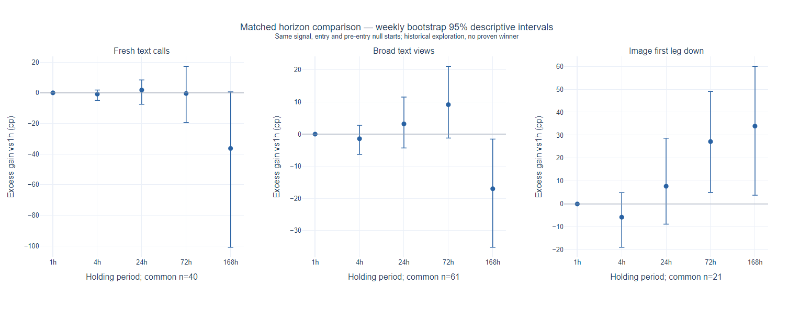

# Alastar 第六轮：持有周期影响与v3更新

2026-10-22。结论：持有期确实改变绝对收益，但现有历史不能确定一个统一最佳周期。文字首次喊单的24小时可继续观察，72小时绝对收益更高却没有稳定的额外优势；图片画空的多日线索较强，但后段只有2笔、表现为负。更新为1/4/24/72/168小时的独立前瞻配对观察，旧1小时v2保留，不直接把某个历史最高格子设为策略。

**后续风险复核：** 用户指出做空期间大涨可能强平，已另存[做空路径专项](../alastar_short_risk_20261022/RESEARCH_NOTES.md)。本轮原统计已检查近似1倍的途中损失，但没有核验标记价、杠杆和保证金权益过程，不能把历史均值当成更高杠杆可实现收益。固定5分钟文字首次17条做空的7天路径中7条上涨≥20%，LAB有到期+11.94%而途中+39.31%的反例。补充研究没有重写本轮冻结数据或前瞻协议。

## 同一批信号下的周期比较

以下每组各周期使用同一批信号、同一小时入场、同向、20bps价格收益；同币去重统一按最长168小时。超额单位为百分点，分母为该笔入场名义金额，均非账户收益。主对照是同币入场前30天、所有周期共同有效的小时起点，起点不晚于入场前168小时。

| 持有 | 文字首次40条：净收益% | 文字首次：同币超额pp | 广义文字61条：净收益% | 图片画空21条：净收益% | 图片画空：同币超额pp |
|---|---:|---:|---:|---:|---:|
| 1小时 | +1.17 | +1.34 | +0.23 | +0.04 | +0.42 |
| 4小时 | +0.42 | +0.54 | -1.18 | -6.25 | -5.34 |
| 24小时 | +3.61 | +3.18 | +3.69 | +3.50 | +8.15 |
| 72小时 | +6.81 | +0.93 | +12.23 | +14.88 | +27.61 |
| 168小时 | +2.08 | -34.98 | -1.37 | +7.10 | +34.35 |

这不是把旧研究换了标签：固定最长周期去重会改变入选交易，与第四轮原成交对账的35笔不是同一分母；本轮小时价格主检验也不等于原5分钟、含资金费的三天主方案。因此广义文字三天的较大新均值不构成推翻第四轮或复活旧方案的独立证据。

## 延长持有是否比1小时更好

对每条共同信号计算“该周期超额 − 1小时超额”，再按周分块自助5000次。以下是未作多重校正的95%描述区间；同一周的相关性保留。

| 信号 | 周期 | 较1h超额增益pp | 95%周块区间pp |
|---|---|---:|---|
| 文字首次 | 24小时 | +1.84 | [-7.48, +8.37] |
| 文字首次 | 72小时 | -0.41 | [-19.38, +17.26] |
| 文字首次 | 168小时 | -36.32 | [-100.89, +0.67] |
| 广义文字 | 24小时 | +3.19 | [-4.30, +11.53] |
| 广义文字 | 72小时 | +9.17 | [-1.23, +21.07] |
| 广义文字 | 168小时 | -17.00 | [-35.19, -1.53] |
| 图片画空 | 24小时 | +7.73 | [-8.77, +28.71] |
| 图片画空 | 72小时 | +27.19 | [+5.02, +49.06] |
| 图片画空 | 168小时 | +33.93 | [+3.83, +59.95] |

联合检验用同一组周级符号翻转，保持周期、信号组及阶段之间的相关性；覆盖40个超额格子和32个非零基准增益格子，取最大绝对统计量。最小校正p分别约0.441和0.278，未确认一个胜出持有期。这个检验依赖周级对称性假设，仍属历史探索，不是随机试验或新的样本外证据。

## 入场时刻、对照窗口和资金费

官方5分钟数据可核验全部40条文字首次、61条广义文字共同信号，但图片共同样本仅12/21条有完整5分钟覆盖，不能把这个子集冒充全量图片复现。模拟入场均为发帖+60秒后的下一根5分钟开盘；这是历史时刻模型，不是真实收件延迟。

| 持有 | 5分钟入场文字首次：净收益% | 共同起点超额pp | 各周期自己的入场前30天起点超额pp | 较1h共同起点增益pp |
|---|---:|---:|---:|---:|
| 1小时 | +1.30 | +1.47 | +1.46 | +0.00 |
| 4小时 | +0.60 | +0.72 | +0.64 | -0.75 |
| 24小时 | +3.37 | +2.94 | +2.10 | +1.47 |
| 72小时 | +6.14 | +0.30 | -1.62 | -1.17 |
| 168小时 | +2.07 | -35.00 | -35.00 | -36.47 |

文字首次72小时的超额会随合理对照定义从小正值变成负值，不能据绝对净收益较高就指定三天。168小时的相对表现更弱；24小时的正增益描述区间仍跨零。图中不同面板纵轴范围不同，区间没有经过联合校正。



[可交互的独立图表](paired_horizon_intervals.html) · [完整90格结果](HORIZON_COMPARISON.csv) · [各周期独立过滤的分母变化](INDEPENDENT_HORIZONS.csv)

下表仅列5分钟入场文字首次的含资金费诊断；价格主检验双方均不计资金费。资金费必须有官方完整查询覆盖，缺失不填零，分母不足40时不与全40条价格均值直接相减。

| 持有 | 资金费覆盖笔数 /40 | 含资金费均值% | 80bps价格收益均值% |
|---|---:|---:|---:|
| 1小时 | 40 /40 | +1.35 | +0.70 |
| 4小时 | 40 /40 | +0.71 | -0.00 |
| 24小时 | 40 /40 | +3.60 | +2.77 |
| 72小时 | 40 /40 | +6.81 | +5.54 |
| 168小时 | 40 /40 | +3.34 | +1.48 |

## 覆盖、稳定性及限制

原始组：文字首次43条、广义文字88条、图片首段画空31条。共同路径／对照有效分别43、87、29条，再统一168小时同币去重后40、61、21条；剔除明细保存在数据目录excluded_signals.json。同一信号组之间有重叠，不能把40+61+21当独立总样本。
图片共同21条中后段仍只有2条：72小时价格净收益约−17.39%、168小时约−37.58%。它们不能代表稳定复现，也不能把图片画空和逆势文字首次混成一个信号。图片7天超额比3天高，并不代表7天绝对收益更高；随机做空本来亏得更多会抬高超额。
按各周期单独去重会改变样本，本轮另存INDEPENDENT_HORIZONS.csv用于解释分母变化，不拿其中最好的一格替代配对主比较。共同起点对照会排除最后7天可开始的短周期起点，所以另列各持有期自己的入场前窗口敏感性；两者都只用入场前价格。
标签和图片仍是已知历史上的解释，可能存在模型历史知识、公开预览修订／删帖、已下架合约遗漏及资金费覆盖限制。近似1倍强平采用与v2相同的1.99倍高价／0.005倍低价界，不是精确标记价格强平；已知亏损不因之后缺口被剔除。

## 实现更新及验收

新增独立v3账本、协议、公共行情适配器和受管网页任务。所有周期的退出时刻在入场前一次冻结；真正取得的未来开盘证据只记录一次，各周期共享该价格。最近四次采集健康、真实首收件、原句、语义置信度、冻结时刻、时钟及30秒捕获约束继续保留；晚到与错过窗口不回填。
v3只收文字首次喊单，仍须人工／本会话语义复核，不自动调用AI。它独立于v2的1小时停止规则；同币168小时内只保留一个观察锚点。这里是信号观察队列，没有账户仓位分配或组合收益，五个持有期不是五笔独立证据。图片多日假设保持独立候选，尚未接通实时图片首版本归档与解释冻结，不伪装为已运行。
各周期到期数可以不同；收益比较仅使用五个周期均到期且共同对照完整的锚点。资金费未全部补齐时不报告含资金费均值，缺失另行重试并追加记录。第40个完整锚点若所有周期超额均值都≤0才停止；对照不齐先暂停；第66个完整锚点集中联合复核，最多24个日历月，没有中途宣布优胜。66是复核点，不是保证多周期检验有足够把握的样本量。
266项相关Python测试、6项前端测试通过。五个周期的前30天官方5分钟零分布已用独立标准库循环复算：分别8629/8593/8353/7777/6625个起点，共同6625个，均值最大差约1.53e-16。原1小时v2的协议、核心、公共数据CLI、跟踪适配器及激活记录保持不变，见v2_preservation.json；实际激活与服务验收回执另附。

## 失败尝试

首次统计运行在大矩阵乘法处发生Windows原生异常0xc06d007f；独立5000×60最小例复现，而2×2不触发。改用数学等价的逐元素乘法求和后完整运行，检验定义未改。Matplotlib误差棒又在transforms.get_affine处触发同样异常，改用Plotly生成同一组点和区间，并用浏览器渲染、截图检查；没有调整依赖或隐藏失败。
新测试初次因模块路径错误在收集期失败，改为tests包路径；之后合成归档在激活前包含未来收件而触发健康门槛，调整为按时序先激活、后收件，未放宽生产门槛。
第一次v3激活遇公共时间接口ReadTimeout，因此未产生激活记录；保持原门槛，用新会话重新核验。激活结果以唯一激活回执和最终运行验收为准。

## 复现

```powershell
$py = 'F:\9_Crypto\.conda\miniforge3\envs\crypto_trading\python.exe'
& $py -m scripts.research_alastar_horizons
& $py -m scripts.plot_alastar_horizons
& $py -m scripts.observe_alastar_horizons status
& $py -m pytest tests/test_alastar_horizons.py tests/test_alastar_horizon_tracker.py tests/test_alastar_forward_paper.py tests/test_alastar_paper_evidence.py tests/test_alastar_observation.py tests/test_alastar_selection_timing.py tests/test_telegram_signal_review.py tests/test_tracker_registry.py tests/test_tracker_measurement.py tests/test_tracker_retirement.py tests/test_web_main_runtime_tasks.py -q
node --test tests/research_tracker_diagnostics.test.cjs
```

研究脚本只读取本地已存公共证据，不调用AI或网络；行情运行器只读固定官方公共端点。重跑分析会保留被替换JSON／CSV的内容哈希历史；激活时另存引用资料的不可变副本。正式激活／独立审计命令不应当成例行重跑命令。没有修改第四／第五轮原始报告、CSV、v1/v2协议，没有下单、提交或推送。

## 实际激活与服务验收

v3已于UTC `2026-10-22T06:24:48.197350+00:00`（北京时间14:24:48）激活。第二次只读时钟核验通过，最短往返读数偏移区间`[+0.1752,+0.2920]`秒；第一次超时未留下激活记录，实际只有一条激活日志。

14:29实际接口验收：模拟模式，统一跟踪器18行；“Alastar 文字 · 多周期观察（v3）”与“Alastar 文字 · 1h基准（v2）”均运行。网页PID33240，v3连续心跳06:29:21.501506及06:29:26.510678，约5.009秒间隔，旧v2激活及三个实现、协议SHA前后相同。新闻及新闻LLM分别仍为PID60368、53536。v3和v2各只有原始一条激活记录，均未冻结真实新样本。

此时最近6小时公开采集217轮，中位97.10秒、p90为132.29秒，最大206.31秒，超过600秒的间隔为0，真正新帖首收件仍为0。当前新闻链路不是5秒交付，不能把心跳或轮询间隔冒充消息延迟。完整回执见`v3_activation_receipt.json`、`runtime_verification.json`及`v2_preservation.json`。

组件验收使用实际接口数据和当前app.js同源渲染函数，浏览器得到2个版本行、5个周期子行，无页面脚本错误；已检查截图布局。图表也已用浏览器渲染并检查3个误差棒面板。证据为`UI_VERIFICATION.json`、`tracker_component.png`及`paired_horizon_intervals.png`。

归档生成器已适配第六轮和v3，机器交接选择新协议、保留旧v2，并继续保留人工文档。针对生成器的13项测试通过（包括1项新增的第六轮识别保护）；与主回归有重叠，不将其叠加成279项独立测试。实际受保护文件的重生成核对见`archive_preservation_receipt.json`。

原生库失败的最小复现（仅用于定位，不是策略运行依赖）：

```powershell
& $py -X faulthandler -c 'import numpy as np; print((np.ones((5000,60)) @ np.ones(60)).mean())'
& $py -X faulthandler -c 'import matplotlib; matplotlib.use("Agg"); import matplotlib.pyplot as p; f,a=p.subplots(); a.errorbar([0,1],[0,1],yerr=[.1,.2])'
```

本次没有修改原生依赖。统计已用等价归约、图表已用Plotly绕开相关调用，最终研究与运行验收均完成。
