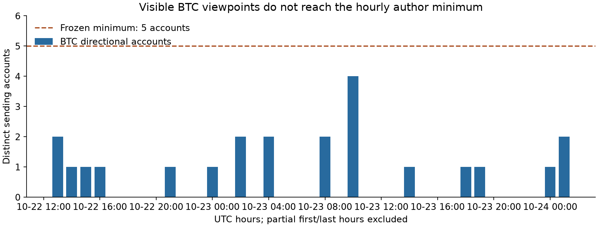

# Telegram 三来源：首轮研究与前向观察

2026-10-24。结论：**当前没有证据支持将这些群直接注册为盈利策略；已建立独立的模拟前向观察。**

## 实际数据与结果

| 来源 | 初始消息 | 文本消息 | 实际覆盖（UTC） | 本轮结论 |
|---|---:|---:|---|---|
| CryptoQuant | 70 | 47 | 09-09 07:47至10-23 13:04 | 均有编辑时间；无法重建原始发布文字，不做这批历史稿的方向收益检验 |
| BinanceChinese | 12,000 | 10,667 | 10-22 12:08至10-24 02:24 | 触及条数上限；47条通过方向复核，其中BTC高置信观点27条、17个账号 |
| Binance_api_Chinese | 544 | 543 | 09-09 13:38至10-23 17:18 | 无合格方向观点；较适合技术故障压力观察 |

主群严格小时规则要求至少5个明确方向账号，但样本中每小时最多4个，因此无合格交易样本。这里不是“回测收益0%”，而是收益、胜率和显著性均不可估计。不能把12,000条快照称作完整45天历史，也不能由约38小时推断长期有效性。

观点需明确提及BTC/ETH/BNB；无明确资产的泛市场情绪不被默认为BTC。机器人和未知发送者不参与人类观点聚合；同一作者重复发言先取均值，再按作者等权。自动分类及另次语义复核均使用项目现有 `gemini-2.5-flash` 配置，模型没有得到价格；这不构成独立人工标注真值，也无法排除模型预训练记忆。

本轮初始小时协议没有信号，未产生收益择优。另依据文本覆盖率，在前向激活时单独登记6小时聚合方案，保留5账号和0.4共识门槛。它是**探索性前向假设**，不冒充通过历史留出检验。此前 [CryptoQuant公开页研究](../telegram_text_20261023/REPORT.md)同样未通过稳定交易信号门槛，不能将其历史正均值当作上线依据。

## 已启动的前向观察

北京时间2026-10-24 10:51:47激活，五本分开观察：CryptoQuant顺势24h、主群小时顺势/反向6h、主群六小时顺势/反向6h。API群另记技术压力，不下方向单。

实际首轮 cycle 成功，三个来源均已加入且增量采集完整；补采主群32条新增，未冻结交易，无成熟收益。后续约20分钟间隔触发过主群差量过大，保护机制将相应区间标为不完整、禁止冻结；03:16 UTC重试已恢复三来源完整，缺口不回填成可用窗口。首次完整窗口尚未结束时，空账本是预期状态。Codex本聊天自动化 `telegram` 已启用，频率已从15分钟调整为每5分钟；只有新信号、实质性结果变化或故障才提醒。它依赖本机与Codex可用，不是独立服务器常驻服务或秒级推送保证。

入场在实际接收、模型完成及窗口结束之后安排；初始历史不回填为前向。费用、实际资金费、同入场做多对照、缺数据和未成熟状态分别保存，五本不混成账户收益。至少100笔成熟样本和8个日历周只是后续研究筛查条件，仍须多重比较及独立验证；任何通过均不自动注册策略或下单。

## 复跑与接手

- [Agent交接文档](../../docs/TELEGRAM_AGENT_HANDOFF.md)：现有加密会话、锁、协议、自动化及状态文件。
- [审计笔记本](audit.ipynb)：依据固定哈希的无正文元数据快照，重算覆盖和零合格信号；[生成/执行脚本](build_notebook.py)。本机没有Jupyter组件，代码单元已通过项目Python顺序执行并保存真实输出，尚未用Jupyter内核验证；图表另行目视检查。
- 数据、协议、脱敏原文、标签、行情回执及哈希journal在 `data/research/telegram_live_20261024/`，Git忽略且本机目录受限。授权状态是用户确认，具体依据待补充；未独立核验所有作者的同意，不向外分发群正文。
- 31项针对性测试通过，覆盖接收/解析时点、历史不能转前向、作者等权、稀疏/空样本、去重、防叠仓、日志篡改、费用/资金费、首次观察编辑稿、正文保留期限及凭据保护。

行情来源为 [Binance公开USDT永续市场接口](https://developers.binance.com/docs/derivatives/usds-margined-futures/market-data/rest-api/Kline-Candlestick-Data)。Telegram文本来自用户账号实际有权访问的三个固定来源；历史当前版本、删除及可见范围限制见交接文档。
