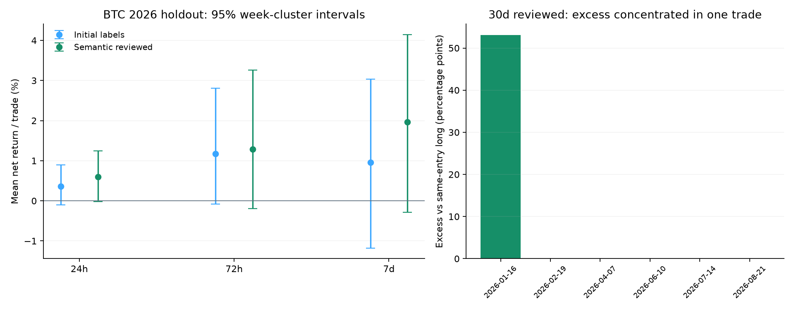

# Telegram 文本信号研究：CryptoQuant 与 Binance 中文群

CryptoQuant 文字具备可提取的方向信息，但本轮没有通过稳定交易信号的证据门槛。两个 Binance 中文群尚未取得群聊历史，不能计算其真实情绪或收益。

## 主要结果

- BTC 24h 原始自动分类：41 笔，平均净收益 +0.36%/笔，胜率 58.5%；95%区间 [-0.10%, +0.90%]。
- 更严格语义复核：28 笔，平均净收益 +0.60%/笔，胜率 67.9%；95%区间 [-0.02%, +1.24%]，多重检验 q=0.488。
- 上述均为单笔入场名义本金的收益，已扣往返20bp成本及资金费，不是账户收益、复利收益或年化收益。
- 2026 留出期两个半段的24h均值为正，但此前开发期为负：原始168笔 -0.38%/笔，复核112笔 -0.56%/笔，跨时期不稳定。
- 语义复核的30天样本只有6笔；相对同入场时点固定做多的全部净增益来自一次做空。去掉该次后超额均值为零；不能将6/6解释为可靠的100%胜率。原始分类的同周期结果为7笔、平均 -6.99%/笔，显示长持有期对文本过滤及首笔非重叠入场非常敏感。
- ETH 的留出样本仅4–7笔，BNB没有留出交易，均不能下有效性结论。

## 数据与时间口径

- 来源仅为 [cryptoquant_official](https://t.me/s/cryptoquant_official)，不是 cryptoquant_alert 自动告警。归档160个公开预览页，2517条文本，覆盖2021-05-19至2026-10-23；达到页数上限，未声称完整频道历史。
- 排除编辑标记156条、重复文本22条，保留2339条。另有10条可见但未解析的消息，未做图片OCR或视频解读。
- 先冻结文本标签和语义复核，再载入行情。开发期截至2026年前并留出7天隔离；留出期自2026-01-01起。
- 本地 Binance USDT 永续小时K线覆盖至2026-10-20 00:00 UTC；需要此后价格或尚未成熟的事件排除。输入文件哈希及副本均已保存。
- 文本至少明确提及BTC/ETH/BNB之一；仅无条件当前方向观点、模型置信度≥0.7入选。每币每源只持有一笔，重叠信号不叠加。
- 入场为发布后至少60秒的下一小时开盘，固定1/6/24/72/168小时退出；30天周期在首次价格对齐前补充登记。无事后止盈止损调参。
- 往返20bp（含手续费及滑点假设），压力40bp；资金费按结算标价相对入场价折算，约定入场时刻之后、退出时刻及之前结算。缺失资金费不当成零。
- 同时检查原始标签及严格语义复核，保留全部结果；复核由同一个模型另次调用完成，并不构成独立人工真值。

## 2026年BTC留出结果

| 标签集 | 持有 | 样本 | 平均净收益/笔 | 胜率 | 周聚类95%区间 | 随机时点q值 |
|---|---:|---:|---:|---:|---|---:|
| 原始自动分类 | 1h | 44 | -0.13% | 25.0% | [-0.30%, +0.12%] | 0.696 |
| 原始自动分类 | 6h | 44 | -0.04% | 47.7% | [-0.33%, +0.28%] | 0.673 |
| 原始自动分类 | 24h | 41 | +0.36% | 58.5% | [-0.10%, +0.90%] | 0.488 |
| 原始自动分类 | 72h | 28 | +1.18% | 60.7% | [-0.08%, +2.81%] | 0.488 |
| 原始自动分类 | 168h | 20 | +0.95% | 60.0% | [-1.18%, +3.03%] | 0.790 |
| 原始自动分类 | 720h | 7 | -6.99% | 57.1% | 不足8个日历周，不报告 | 0.293 |
| 语义复核 | 1h | 30 | -0.04% | 30.0% | [-0.26%, +0.31%] | 0.488 |
| 语义复核 | 6h | 30 | -0.02% | 50.0% | [-0.43%, +0.42%] | 0.696 |
| 语义复核 | 24h | 28 | +0.60% | 67.9% | [-0.02%, +1.24%] | 0.488 |
| 语义复核 | 72h | 22 | +1.29% | 63.6% | [-0.19%, +3.27%] | 0.488 |
| 语义复核 | 168h | 17 | +1.96% | 70.6% | [-0.28%, +4.14%] | 0.683 |
| 语义复核 | 720h | 6 | +9.81% | 100.0% | 不足8个日历周，不报告 | 0.067 |

## 对照与统计

- 对照包括相同入场时刻固定做多、同入场反向交易、同币同方向且相同UTC小时的附近随机时点。
- 随机时点取±28日，排除与事件相隔不超过持有时长的日期；30天持有用±90日。所有随机对照仍须价格及资金费完整，且在同一开发/留出区间。
- 5,000次随机时点抽样；2,000次按日历周聚类bootstrap；对24个有效留出检验进行BH FDR校正。抽样种子固定，少于8周不报告周聚类区间。
- 24h复核样本低于事前30笔门槛，净收益区间及相对固定做多超额区间均跨零，随机时点校正后也未通过，故不接入执行或注册为策略。

## Binance 中文群：等待历史文件

- 已核验[官方中文群](https://t.me/BinanceChinese)与[API中文群](https://t.me/Binance_api_Chinese)的公开简介；公开预览未提供消息历史。本次工具不能读取桌面版Telegram中的消息。
- 已准备JSON导入、凭据及联系方式脱敏、UTC时间校验、作者去标识化、去重及文本分类。API报错、代码、签名和订单参数讨论不能算看空/恐慌。
- 情绪特征按已结束的UTC小时聚合，每位作者每币每小时等权；至少5位有方向观点的作者、绝对多空不平衡度≥0.4才形成待测候选。两个群分别计算，不能与研究频道或彼此混成同一情绪分数。该特征提取器已测试，但尚无真实群数据验证。
- 请从每个群右上角菜单分别导出聊天记录为JSON，尽量至少6个月，关闭媒体。Telegram官方支持[单独聊天导出](https://telegram.org/blog/export-and-more)。确认导出的是群内可见历史，而非仅自己的发言。
- 文件可放到 `data/research/telegram_exports/BinanceChinese/` 和 `data/research/telegram_exports/Binance_api_Chinese/`；收到路径后才能继续真实情绪回测。不要提供整个账号资料目录。

## 边界与审计

- 公开预览是采集时可见文本，编辑前版本、删除帖、最初发布时间的可见性均无法还原；即使无编辑标记，也不保证文字从未改动。消息ID缺口原因未知。
- 模型没有收到后续行情及时间戳，但预训练记忆造成的历史知识影响无法完全排除；结果属于回溯探索，不能冒充前向验证。
- 16条按开发/留出及方向分层抽查暴露了历史类比、描述性指标和混合观点的噪音，因此在首次价格对齐前登记了第二轮语义敏感性检验。没有根据收益手改标签。
- 两条首轮格式/证据问题通过离线语义复核解决，记录在 manual_label_resolutions.json；所有原始模型尝试及保守拒绝记录保留。
- 未发送Telegram消息、改动群成员关系、注册策略或提交订单。27项相关测试通过。

## 可复跑文件

- `data/research/cryptoquant_text_20261023/protocol.json`：原规则与冻结时间。
- `review_protocol.json`、`frozen_labels.jsonl`、`semantic_review/`：二次规则、原始标签及复核。
- `results.json`、`event_outcomes.jsonl`、`market_snapshot/`：汇总、逐笔、价格副本。
- `scripts/research_telegram_text.py backtest --market-root data/research/cryptoquant_text_20261023/market_snapshot`：使用项目解释器，可完全离线重跑行情部分。
- [审计笔记本](audit.ipynb)：已执行；校验输入哈希并从快照重新计算两个24h结果。
