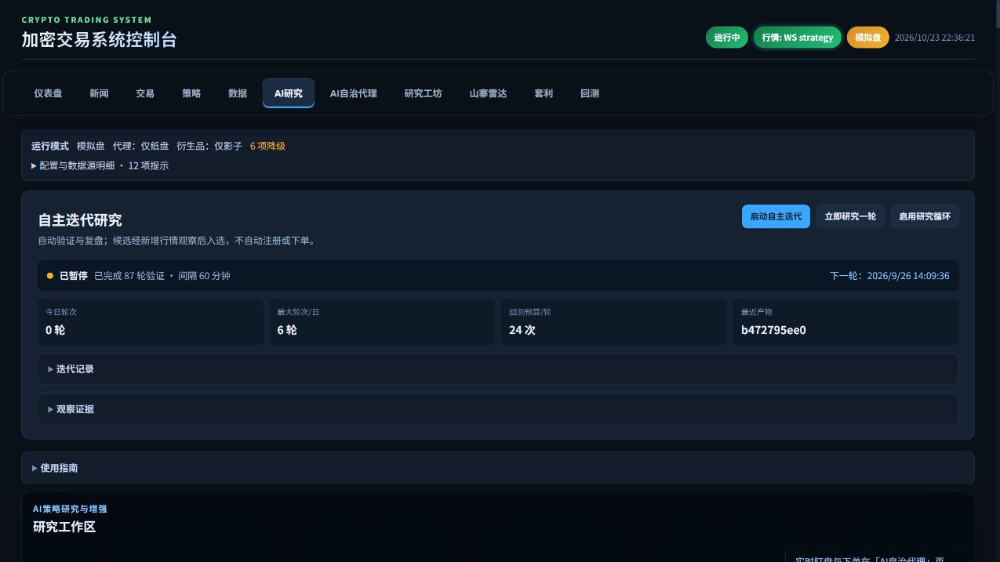

# 控制台界面整理

日期：2026-10-23

## 已完成

- 精简主标题、副标题、重复说明和装饰性文案，沿用现有深色主题与颜色 token。
- 首页保留关键风控状态和告警，重复的盈亏构成放入明细；未熔断时不显示解除按钮。
- 通知配置、账户管理、审计、数据维护、历史回放、操作回执和诊断按需展开。
- 普通订单隐藏冰山及算法参数，按订单模式显示相应字段；止盈、止损与仅减仓直接保留，追踪止损可展开。
- 策略导入导出与评分归入辅助入口，健康检查或导出等操作会展开结果区。
- 纸面跟踪器规则及多周期对比可展开，继续显示样本口径、Alastar 自动解析状态、启用时间和空数据原因。
- AI 研究主工作区提前，2 个因子循环和 14 个观察账本集中到页面下方；展开状态在刷新时保留，循环启用和异常信息显示在摘要。
- 新闻页统一展示层级，采集、补拉与失败历史维护集中收起，队列计数继续直接显示。
- 雷达页删除宣传性表述，保留模型局限、流动性与非买入信号提示。
- 修复代理状态请求完成前切走页面时，对空调度结果调用 `.catch()` 的异常。

## 验证

- Python 界面资源、风控和余额回归：50 项通过。
- Node 跟踪器、归因、风险展示及代理调度：12 项通过。
- 修改的 JavaScript 语法检查和 Git 差异空白检查通过。
- 浏览器核对 11 个主导航页及独立 `/news` 页；当前桌面视口未发现页面横向溢出、重复 ID。
- 模板内 308 个带 ID 的 input / select / textarea / button 均仍存在。
- 验证普通单、冰山单和 TWAP 字段切换；验证导入导出、因子循环、观察账本与新闻维护的展开入口。
- 服务通过受管启动器以 paper 模式启动，资源版本已更新。

## 验证范围

本次验证页面布局、展开交互和相关回归；未提交订单、启动研究、调用通知发送或执行历史回补。浏览器期间新闻请求出现过超时，数据源状态也有降级，错误提示保持可见；本次没有改动这些后端数据链路。未开展移动设备视口专项检查。

## 截图

